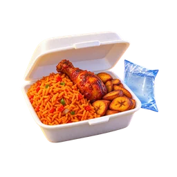
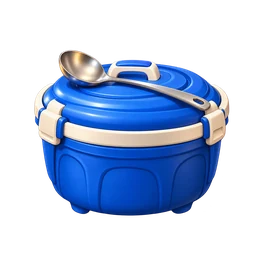
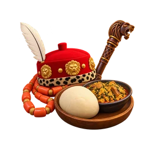
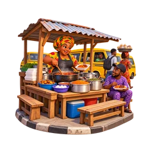
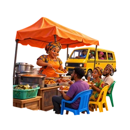
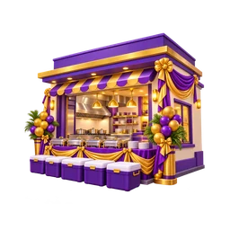
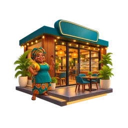

# Character, object and place art gallery

All **29 prompts** in [ART_PROMPTS.md](ART_PROMPTS.md) have artwork generated with the built-in image tool.

Each selected image has a transparent **1024 x 1024 PNG master** in `art/ui/` and a **256 x 256 WebP** in `public/ui/`. Exact prompts, hashes and sizes are in [generation.json](../art/ui/generation.json).

Staff, online-order, event and branch keys are used by the current UI. Rider, pack, cooler and customer keys are available for future UI use, as described in the prompt document. The scene characters and bikes remain procedural.

The dedication and wedding v2 images are selected; earlier versions remain preserved.

| Key | Preview and master |
| --- | --- |
| `staff:chidi` |  |
| `staff:bisi` |  |
| `staff:basira` |  |
| `staff:tunde` |  |
| `staff:emeka` |  |
| `staff:musa` |  |
| `staff:ngozi` |  |
| `online` |  |
| `rider` |  |
| `pack` |  |
| `cooler` |  |
| `event:birthday` |  |
| `event:naming` |  |
| `event:dedication` |  |
| `event:wedding` |  |
| `event:burial` |  |
| `event:housewarming` |  |
| `event:chieftaincy` |  |
| `place:ojuelegba` |  |
| `place:yaba` |  |
| `place:mushin` |  |
| `place:ikeja` |  |
| `place:lekki` |  |
| `place:abuja` |  |
| `customer:odogwu` |  |
| `customer:okada` |  |
| `customer:conductor` |  |
| `customer:schoolkid` |  |
| `customer:alhaji` |  |
