# Food icon gallery

All 21 foods from [FOOD_ART_PROMPTS.md](FOOD_ART_PROMPTS.md) are installed through [the runtime manifest](../public/food/manifest.json).
Generated with the built-in image tool. Each image has genuine transparency, a 1024 × 1024 PNG master and a 256 × 256 WebP runtime copy.
Click a food name to open its master. Exact generation prompts and hashes are recorded in [generation.json](../art/food-icons/generation.json).
The earlier jollof prototype is preserved separately; the installed v2 adds the peas, carrots and onion rings in the document.

See [FOOD_ART_VERIFICATION.md](FOOD_ART_VERIFICATION.md) for asset validation and test results.

| Food | Food | Food |
| --- | --- | --- |
| [**Jollof Rice**](../art/food-icons/jollof-v2.png) 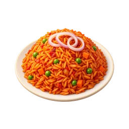 <code>jollof</code> | [**Fried Rice**](../art/food-icons/friedrice-v1.png) 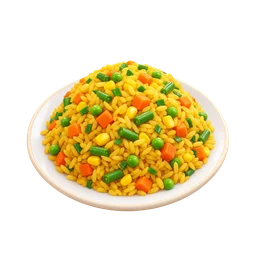 <code>friedrice</code> | [**Rice & Stew**](../art/food-icons/whiterice-v1.png) 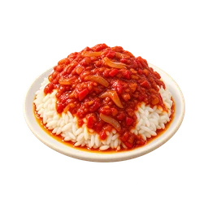 <code>whiterice</code> |
| [**Ewa Agoyin**](../art/food-icons/beans-v1.png) 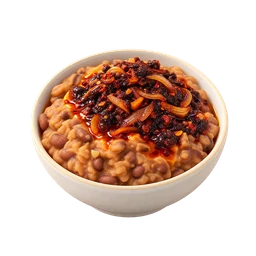 <code>beans</code> | [**Eba**](../art/food-icons/eba-v1.png) 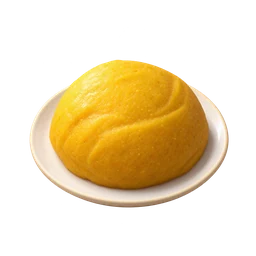 <code>eba</code> | [**Amala**](../art/food-icons/amala-v1.png) 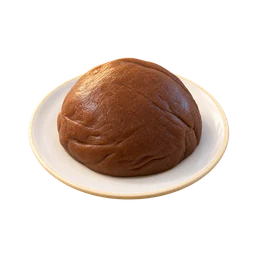 <code>amala</code> |
| [**Pounded Yam**](../art/food-icons/poundedyam-v1.png) 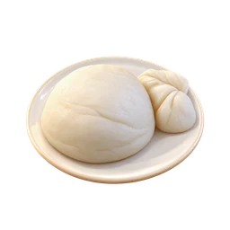 <code>poundedyam</code> | [**Goat Pepper Soup**](../art/food-icons/peppersoup-v1.png) 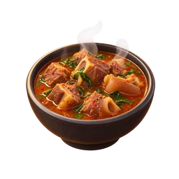 <code>peppersoup</code> | [**Egusi Soup**](../art/food-icons/egusi-v1.png) 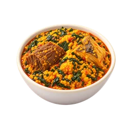 <code>egusi</code> |
| [**Efo Riro**](../art/food-icons/efo-v1.png) 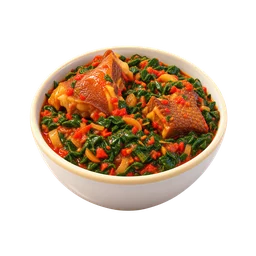 <code>efo</code> | [**Ewedu & Gbegiri**](../art/food-icons/ewedu-v1.png) 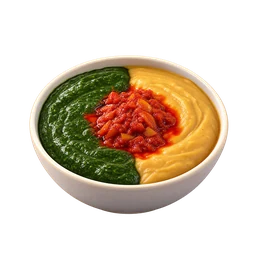 <code>ewedu</code> | [**Beef**](../art/food-icons/beef-v1.png) 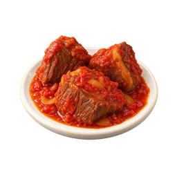 <code>beef</code> |
| [**Fried Chicken**](../art/food-icons/chicken-v1.png) 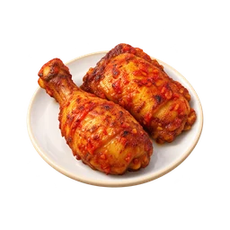 <code>chicken</code> | [**Fried Fish**](../art/food-icons/fish-v1.png) 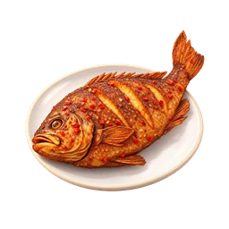 <code>fish</code> | [**Boiled Egg**](../art/food-icons/egg-v1.png) 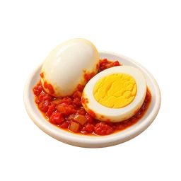 <code>egg</code> |
| [**Dodo**](../art/food-icons/plantain-v1.png) 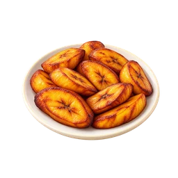 <code>plantain</code> | [**Moi Moi**](../art/food-icons/moimoi-v1.png) 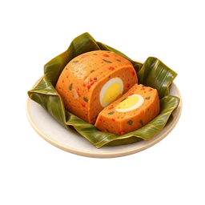 <code>moimoi</code> | [**Pure Water**](../art/food-icons/water-v1.png) 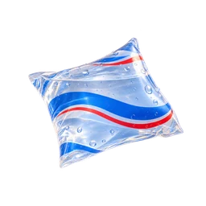 <code>water</code> |
| [**Zobo**](../art/food-icons/zobo-v1.png) 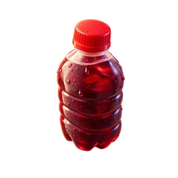 <code>zobo</code> | [**Mineral**](../art/food-icons/mineral-v1.png) 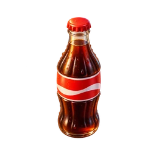 <code>mineral</code> | [**Malt**](../art/food-icons/malt-v1.png) 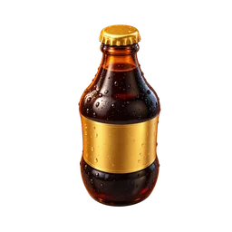 <code>malt</code> |
